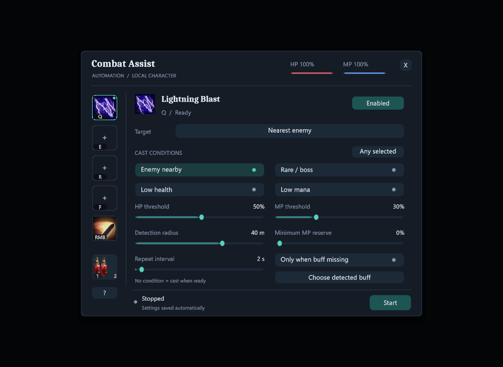
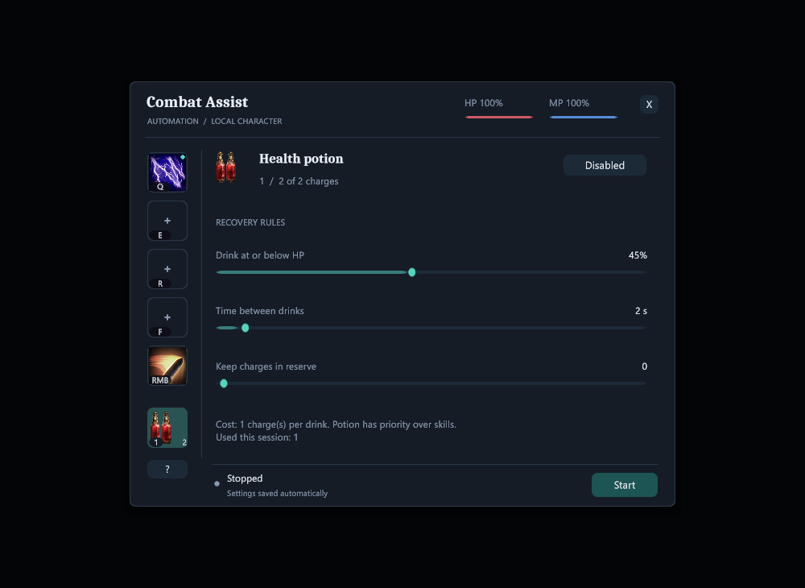

# Bản 1.1.0-dev.12 — Combat Assist F1 và Shared Stash

Protocol **35**. Đóng game trên từng máy rồi chạy `update.bat` để cài cả cặp DLL.
Dùng Play Offline. Không xóa UserData, save hoặc journal SharedChest.

## F1 Combat Assist

- Panel gọn 680x530, icon thật của từng skill/potion, hotkey badge, cooldown,
  viền mục đang chọn và dấu enabled. Body font sans, nền slate và accent teal.
- Chọn icon, Configure this skill nếu chưa xác nhận, rồi Enable. Đổi skill trong
  slot yêu cầu xác nhận lại. Cấu hình lưu riêng từng nhân vật.
- Target Self/buff, enemy gần nhất hoặc rare/boss. Trigger theo enemy/rare/boss
  trong bán kính, HP/MP dưới ngưỡng; chọn ANY hoặc ALL. Không chọn trigger = thử
  khi cooldown/charge và khoảng nghỉ cho phép. Có minimum MP reserve.
- Potion đọc charge/max/cost thật, uống dưới ngưỡng HP, giữ reserve và interval.
- Start rồi đóng F1/F4 để chạy. Panel/chat/loading/dead/travel/mất focus tạm dừng;
  manual cast được ưu tiên. Start không được lưu tự bật. LAN room là tùy chọn.
- Buff guard chỉ đọc native stat-buff name: cast buff một lần rồi chọn tên đọc
  được. Giữ toggle aura manual nếu không đọc được active buff; không suy đoán
  mọi aura/minion/toggle là stat buff. Dùng lệnh skill/potion native, không sửa
  HP/MP/charge/cooldown hoặc điều khiển nhân vật peer.

## F2 Shared Stash

Sửa Client party-only bị Available=false khi Host đang chạy Echo, khiến Host bỏ
qua query kho. F2 dùng được khác map, không cần Teleport, sau khi load nhân vật,
kết nối room và cùng cycle/mode. Local readiness tách khỏi quyền shared world:
Client chưa mượn Echo không nhận world/combat/scaling của Host chỉ vì trùng scene
hoặc còn participation từ lần Teleport cũ. Giữ custody, reservation và save ACK.
Có thêm trạng thái chờ và diagnostics; không reset dữ liệu hòm.

## Kiểm chứng và giới hạn

- Build 0 warning/error; 7 compiled audit checks; native basic smoke đạt trên cặp cuối.
- Core không đổi giữa dev.11 và dev.12: baseline 752 managed checks, gồm 30 Auto Play
  và các kiểm tra readiness/TCP Shared Stash bổ sung sau dev.9. Không gọi đây là
  kiểm thử lại mọi gameplay của dev.12.
- Native Mage QA: đọc bar/key/cooldown/HP/MP, icon thật, actual Lightning Blast cast,
  potion trừ charge/hồi máu, khoảng nghỉ, Start/Stop raycast và input restore đạt.
  Hai ảnh Canvas render đã xem lại; không phải nghiệm thu hai máy hoặc mọi class.
- Full rendered campaign gate vẫn **FAIL với 76 runtime errors** (duplicate init,
  offline identity, Actor null/NRE). Feature observations đạt ghi riêng. Không
  claim đã sửa lỗi ActorVisuals trước đây hoặc full campaign pass.
- Shared Stash native Client view khác map/Host Echo đã kiểm ở dev.10; đây là
  regression baseline trên cặp đó, không gọi là native test lại dev.12.
- Room LootFilter của dev.9 được giữ lại. Encounter vẫn tạm gác và chưa nối native
  gameplay. Không đồng bộ các tương tác/reward Encounter mới.

SHA256 Mod: `A0A36F6F1F6264AB3EB723E136F1F0EB49AF0FBB58167E8B59EF54D479DD7E07`

SHA256 Core: `6547E098776B12DBDD58DB7CF097D8A75972FE361726087A61135ADDD9B3D59F`

Evidence: validation/native-ui-release-dev12.json, native-basic-dev12.json,
audit-dev12-ui.json và managed-dev12-core-baseline.json. Public updater đạt 15
fixture checks trước push và 17 checks gồm tải thật hai DLL từ GitHub sau push;
xem validation/public-updater-dev12.json.
